# Guía para entender el proyecto

Para leer una vez y volver cuando algo no se acuerde. No repite el código: dice **qué leer, en qué orden y qué debes poder explicar**.
Cómo instalar y qué hace el juego está en el [README](../README.md); cómo publicarlo, en [PUBLICAR.md](PUBLICAR.md).

## 1. El mapa en cinco líneas

```
Navegador                                              Servidor
 Phaser (la caja, los clientes)  ←datos→  app.js  ──jQuery/AJAX──►  public/api/*.php
 lógica pura en JS (dinero, venta, auditoría…)                       └► Services (reglas, transacciones)
                                                                         └► Repositories (SQL) ► MySQL
```

- **Backend (PHP):** dueño de los precios, el IVA, el stock, las jornadas y las ventas. Tres capas: *endpoint* (HTTP) → *service* (reglas y transacciones) → *repository* (SQL). Cada capa se prueba y se cambia sin tocar las otras.
- **Frontend:** el juego (Phaser) **no llama a la API**. [app.js](../public/assets/js/app.js) hace las peticiones y le entrega datos y funciones al juego (`Juego.setCatalogo`, `setJornada`, `setJornadaHooks`, `setCobrador`). Así el juego se puede probar sin servidor.
- **Lógica pura** (sin Phaser ni DOM, con pruebas en `tests/js`): `money`, `pricing`, `venta`, `auditoria`, `cobro`, `compra`, `reloj`, `paciencia`, `perfil`, `jugador`, `nombres`.
- **Regla de oro:** el navegador *propone* la venta y la API la *confirma*. Subtotal, IVA, descuento, total y cambio se leen siempre de la respuesta de `checkout.php`; el servidor nunca confía en precios del cliente.

## 2. Cómo se juega una venta (y qué pasa por detrás)

1. **Escanear:** los productos envasados se arrastran al escáner; las frutas y verduras no tienen código: van a la balanza y se cobran tecleando su PLU (mapa `PLU` en `assets.js`). La cantidad que se envía a la API son los kg enteros.
2. **PAY:** el cliente saca sus billetes (`Cobro.generarBilletes`, siempre alcanzan para la cuenta). El tendero **lee la bandeja y teclea la suma**.
3. **Confirmar:** el juego llama a `Juego.cobrar({carrito, efectivo, cliente})`, que `app.js` convierte en `POST checkout.php`. La llamada es **atómica y no idempotente**: valida el efectivo, calcula el cambio, crea la venta y descuenta el stock de una vez. Por eso el teclado se bloquea mientras llega la respuesta (un doble clic crearía dos ventas).
   - `422`: efectivo insuficiente, se puede reintentar. `409`: stock o jornada, no se creó nada.
4. **ENTREGAR:** es solo el gesto de dar la bolsa; el cobro real ya ocurrió. El cliente se va y entra otro.

**Pérdidas** (se ven al cerrar la jornada, no en el momento): [auditoria.js](../public/assets/js/auditoria.js) compara lo que el cliente *se lleva* con lo que el tendero *cobró*.

| Concepto | Significa | Efecto |
|---|---|---|
| faltantes | se llevó algo que no se cobró (o se dio cambio de más) | **pérdida**: se resta del sueldo base (nunca baja de 0) |
| sobrantes | se cobró de más | **sobrecobro**: el cliente protesta, −50 puntos |
| venta exacta | ni lo uno ni lo otro | +100 puntos |
| abandono | la paciencia se agotó | −50 puntos, sin pérdida de dinero |

Al cerrar, el juego manda `faltantes`/`sobrantes`/`perdida`/`sobrecobro` a `jornada_cerrar.php`: los faltantes descuentan stock, los sobrantes lo reponen y los importes quedan en la jornada. Los importes los calcula el navegador; ver «Riesgos» en [PUBLICAR.md](PUBLICAR.md).

**Varios jugadores sin cuentas:** cada navegador crea un UUID (`jugador.js`) y lo manda en la cabecera `X-Jugador`. Con él cada jugador tiene **su** jornada abierta y **su** stock (`stock_jugador`, parte del stock base de `productos`). Lo ajeno responde 404.

**Dónde se guarda qué:**

| Dato | Dónde | Cuánto dura |
|---|---|---|
| Jornada, ventas, stock | MySQL | siempre |
| Reloj, clientes en fila, paciencias, acumulado de la jornada | `sessionStorage` (`d2-progreso`) | hasta cerrar la pestaña; se borra al cerrar la jornada |
| Puntos, récords, jornadas jugadas | `localStorage` (`d2-perfil`) | hasta borrar los datos del sitio |
| Identificador del jugador, sonido, ayuda vista | `localStorage` | ídem |

## 3. Diagramas: arquitectura y flujos

Están en [Mermaid](https://mermaid.js.org/): GitHub los dibuja solo; en VS Code instala la extensión *Markdown Preview Mermaid Support* y abre la vista previa. Cada diagrama indica el archivo donde está lo que muestra.

### 3.1 Arquitectura por capas

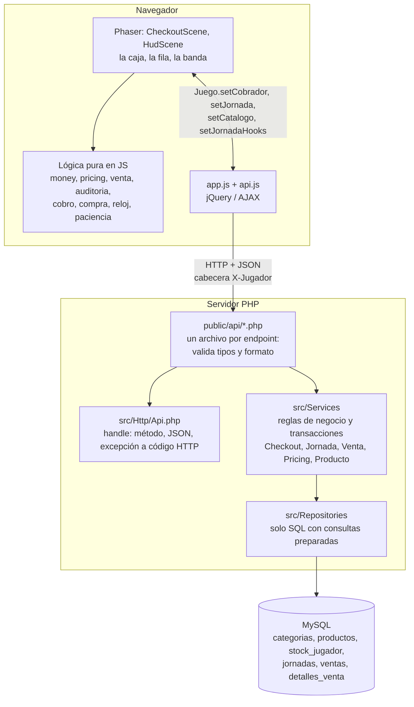

Qué debes poder decir: cada capa solo habla con la de abajo. El *endpoint* no tiene reglas, el *service* no escribe SQL y el *repository* no decide nada. El juego nunca llama a la API: lo hace `app.js`.

### 3.2 Quién llama a quién (mapa de endpoints)

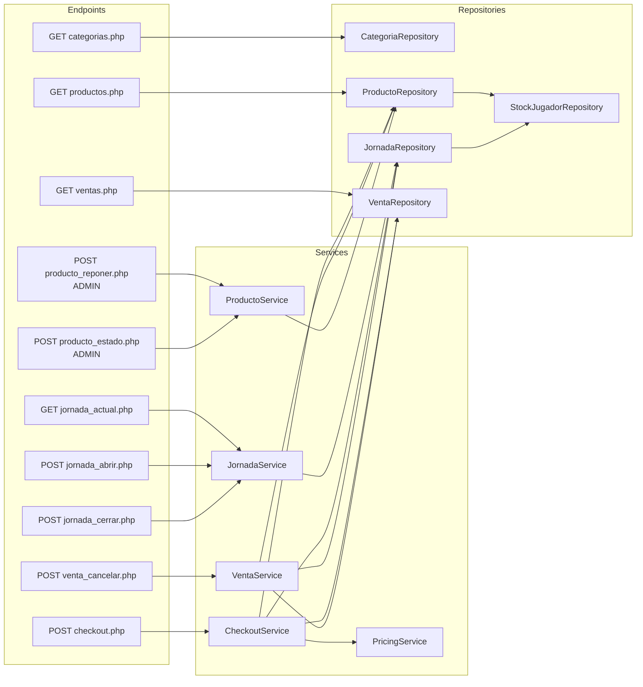

`categorias.php` y `ventas.php` son lecturas simples y hablan directo con el repositorio. `producto_reponer` y `producto_estado` exigen `X-Admin-Token`.

### 3.3 Qué pasa con CUALQUIER petición (`Api::handle`)

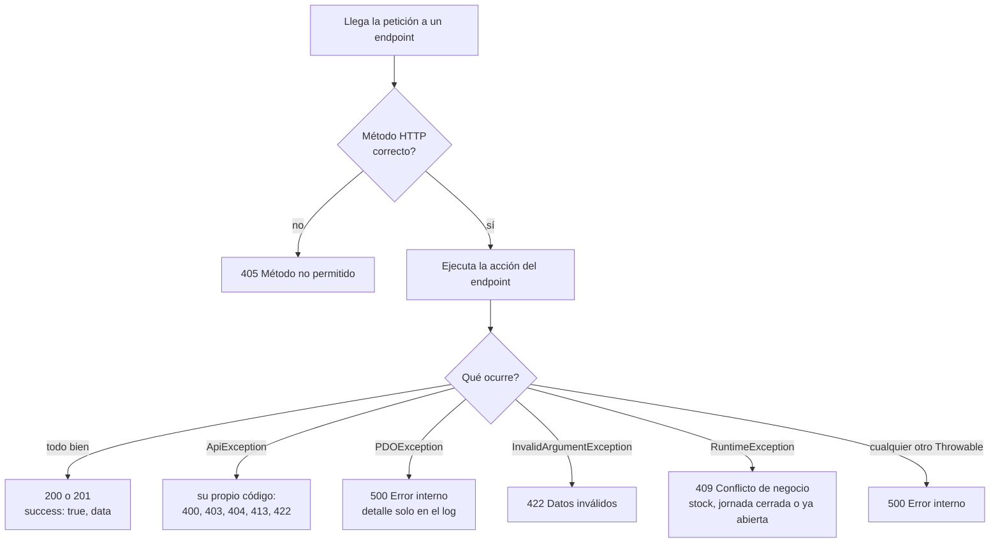

El orden de los `catch` importa: `PDOException` extiende `RuntimeException`, así que si fuera después un error de la base saldría como un 409 falso.

Dentro de la acción, casi todos los endpoints hacen este recorrido antes de llegar al *service*:

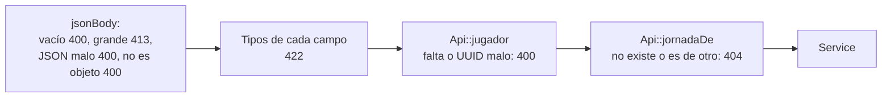

### 3.4 El cobro: `POST checkout.php` (el flujo más importante)

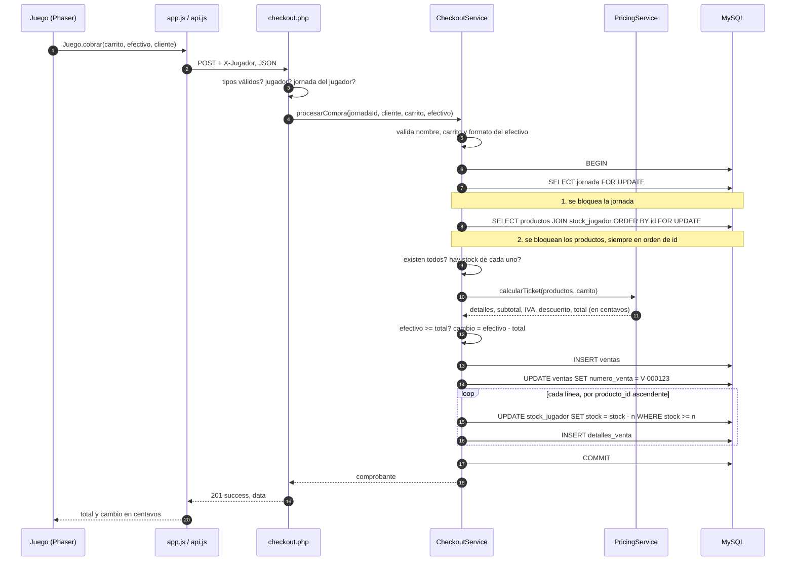

Y las decisiones que toma por el camino (cada rombo es un punto de fallo; si falla, hace `ROLLBACK` y no queda nada a medias):

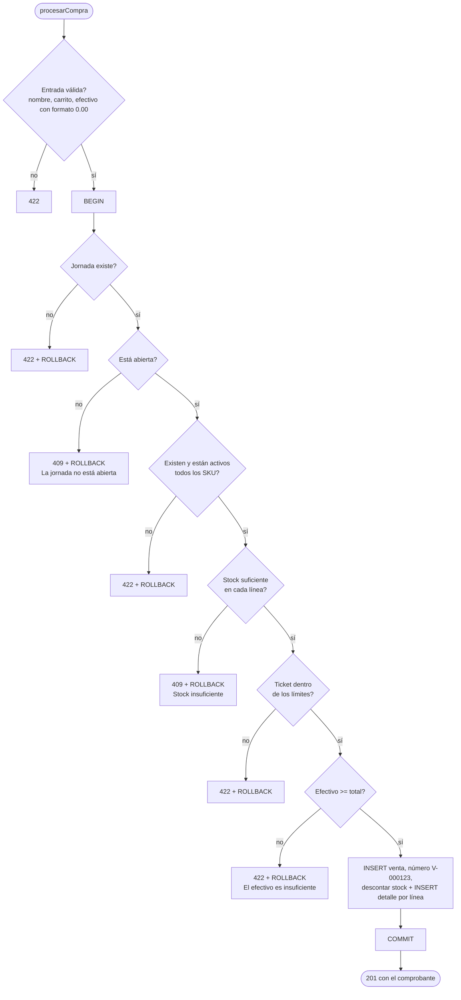

### 3.5 Cómo calcula `PricingService` el ticket

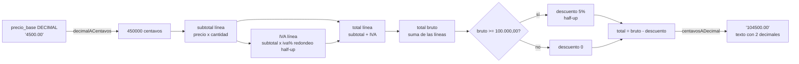

Todo se hace con enteros; el `float` nunca toca el dinero. Antes de multiplicar se comprueba que no se pase de `MAX_IMPORTE_CENTAVOS`, para que un entero de 64 bits no desborde. El navegador repite el cálculo en `pricing.js` y las pruebas comparan 300 cestas contra este PHP.

### 3.6 La jornada: ciclo de vida

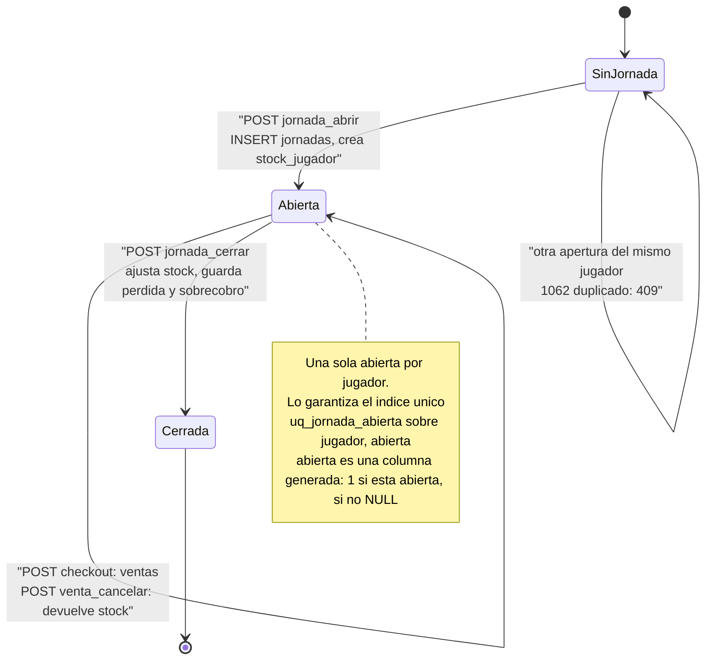

Cierre de jornada, paso a paso:

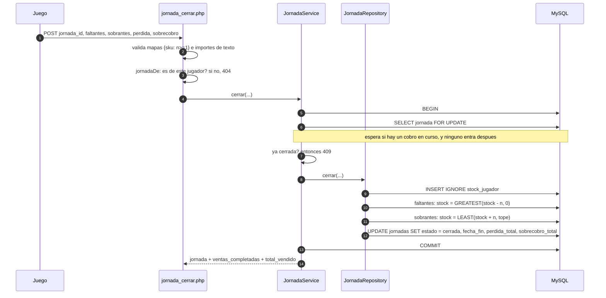

### 3.7 Cancelar una venta

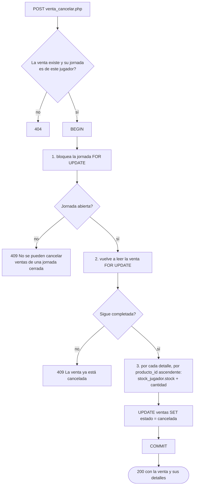

Se relee la venta con el bloqueo puesto porque entre la primera lectura y el bloqueo otro proceso pudo cancelarla (*TOCTOU*).

### 3.8 Por qué no hay deadlocks: orden de bloqueos

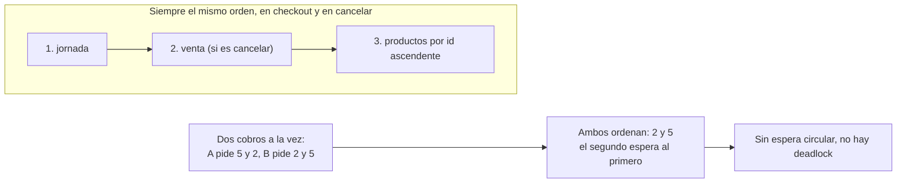

### 3.9 Varios jugadores sin cuentas: stock propio

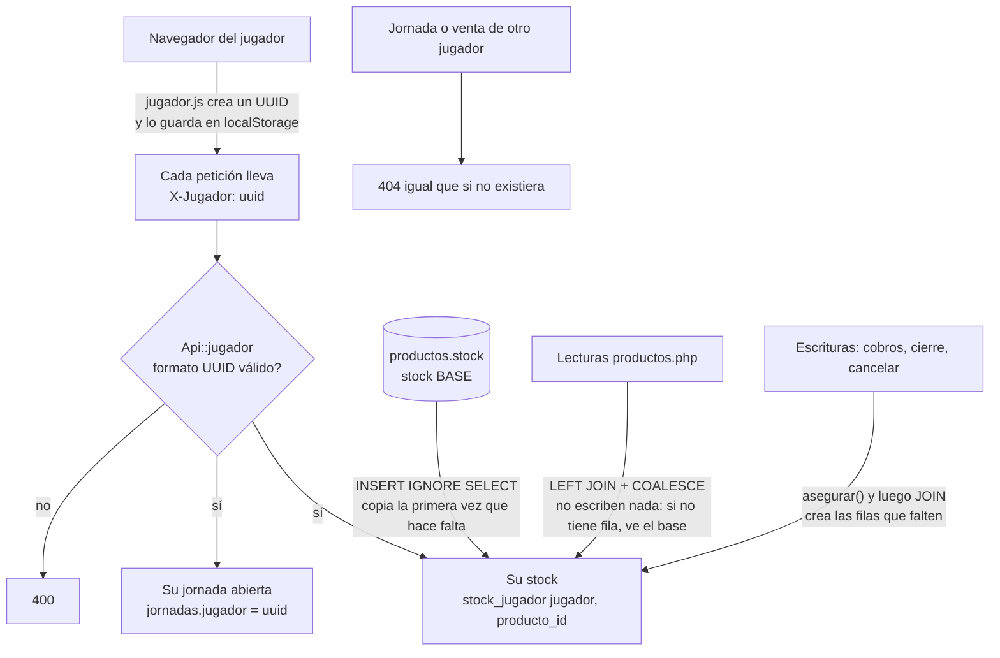

### 3.10 Modelo de datos

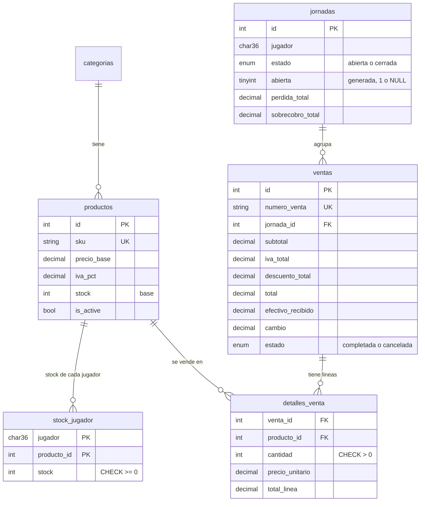

Las reglas que protege la base aunque el PHP falle: `stock >= 0`, importes `>= 0`, `cantidad > 0`, `sku` y `numero_venta` únicos, y **una sola jornada abierta por jugador** (índice único sobre la columna generada).

### 3.11 Las consultas SQL, operación por operación

| Operación | Consulta (resumida) | Bloqueo / garantía |
|---|---|---|
| Catálogo | `SELECT … FROM productos p LEFT JOIN stock_jugador sj ON … AND sj.jugador = ? WHERE p.is_active = 1`, con `COALESCE(sj.stock, p.stock)` | solo lectura; no crea filas |
| Jornada actual | `SELECT … FROM jornadas WHERE estado = 'abierta' AND jugador = ? LIMIT 1` | — |
| Resumen de jornada | `SELECT COUNT(*), COALESCE(SUM(total),0) FROM ventas WHERE jornada_id = ? AND estado = 'completada'` | — |
| Abrir jornada | `INSERT INTO jornadas (estado, jugador) VALUES ('abierta', ?)` y luego `INSERT IGNORE INTO stock_jugador … SELECT ?, id, stock FROM productos` | el índice único rechaza la segunda abierta (error 1062 a 409) |
| Cobrar: jornada | `SELECT … FROM jornadas WHERE id = ? FOR UPDATE` | bloquea la fila hasta el commit |
| Cobrar: productos | `SELECT … FROM productos p JOIN stock_jugador sj … WHERE p.sku IN (?,?) AND p.is_active = 1 ORDER BY p.id FOR UPDATE` | bloquea en orden de id |
| Cobrar: escribir | `INSERT INTO ventas …` · `UPDATE ventas SET numero_venta = ?` · por línea `UPDATE stock_jugador … SET stock = stock - ? WHERE … AND stock >= ?` · `INSERT INTO detalles_venta …` | la condición `stock >= ?` es el segundo seguro; si no actualiza ninguna fila, lanza excepción |
| Cancelar venta | bloqueo de jornada y de venta, `UPDATE stock_jugador SET stock = stock + ?`, `UPDATE ventas SET estado = 'cancelada'` | mismo orden de bloqueos |
| Cerrar jornada | bloqueo de jornada, `UPDATE stock_jugador SET stock = GREATEST(stock - ?, 0)` / `LEAST(stock + ?, tope)`, `UPDATE jornadas SET estado = 'cerrada', … WHERE id = ? AND estado = 'abierta'` | el `WHERE estado = 'abierta'` evita cerrar dos veces |
| Reponer (admin) | `UPDATE productos SET stock = stock + ? WHERE id = ? AND stock <= ?` | el tope va en el `WHERE`; si no afecta ninguna fila, 409 |

Todas usan **parámetros `?`** (consultas preparadas): los datos nunca se pegan al texto SQL, así que no hay inyección.

### 3.12 La lógica del juego (navegador)

Arranque de la página:

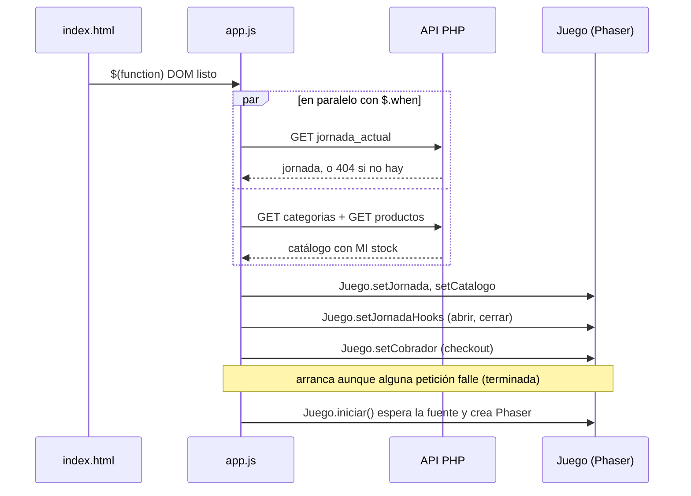

Vida de un cliente en la caja:

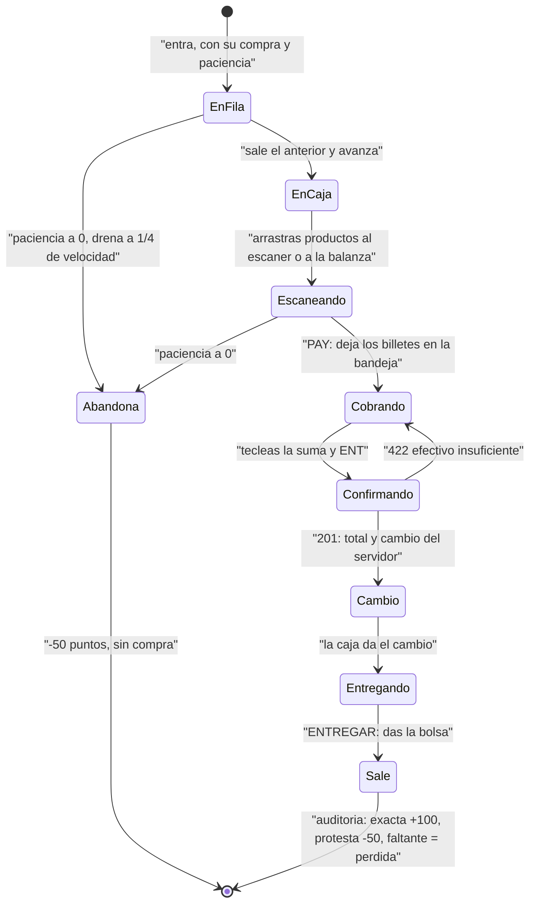

Cierre del turno, visto desde el juego:

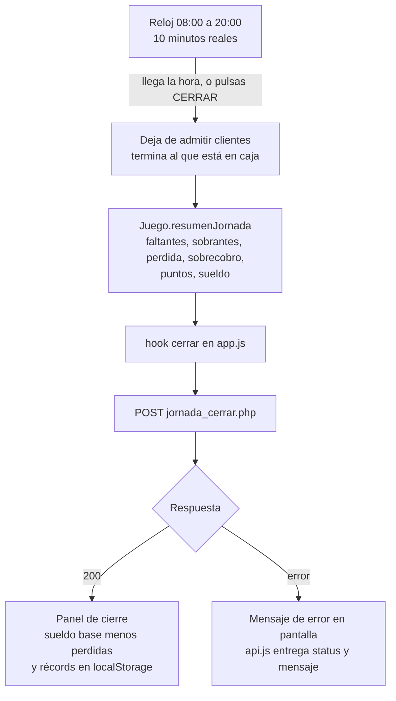

## 4. Conceptos del backend (lo que te pueden preguntar)

Orden de lectura: [Env](../src/Config/Env.php) y [Database](../src/Config/Database.php) → [init.sql](../database/init.sql) → Repositories → Services (Pricing → Checkout → Jornada → Venta → Producto) → [Api.php](../src/Http/Api.php) y los endpoints de [public/api/](../public/api/) → `tests/`.

### 4.1 Dinero con enteros, no con `float`
- `PricingService::decimalACentavos()` convierte `"1234.50"` en `123450`. Con `float`, `0.1 + 0.2 !== 0.3`; con centavos enteros las cuentas son exactas.
- El IVA se redondea *half-up* **por línea**; el descuento es 5 % si el total con IVA llega a 100.000.
- Se valida el tope (`MAX_IMPORTE_CENTAVOS`) **antes** de multiplicar, comparando con `intdiv(MAX, cantidad)`, para que un número enorme no desborde el entero.
- En JSON el dinero viaja como **texto** con dos decimales (`"2500.00"`). El navegador usa [money.js](../public/assets/js/money.js) (misma idea, en centavos).

*Explica:* por qué no `float`; qué es el redondeo half-up; por qué se compara con `intdiv` en vez de multiplicar y luego comparar.

### 4.2 PDO y consultas preparadas
- Todo es `prepare()` + `execute([...])`: nunca se concatenan valores en el SQL, así que no hay inyección SQL. Para `IN (...)` se generan los `?` a mano.
- `ERRMODE_EXCEPTION`: un error de SQL lanza excepción en vez de fallar en silencio.

### 4.3 Transacciones y bloqueos (lo más importante)
- [CheckoutService::procesarCompra](../src/Services/CheckoutService.php): valida → `beginTransaction` → bloquea jornada → bloquea productos → calcula → inserta → `commit`. Cualquier excepción → `rollBack` y se relanza.
- `SELECT … FOR UPDATE` bloquea las filas hasta el commit: el precio y el stock no cambian a mitad del cobro.
- `ORDER BY` en esos selects: todos bloquean en el **mismo orden**, así que no hay *deadlocks*.
- `UPDATE … WHERE stock >= ?` es la segunda defensa: el stock nunca queda negativo.
- El mismo patrón se usa al cerrar la jornada y al cancelar una venta.

*Explica:* qué es ACID; qué hace `FOR UPDATE`; qué es un deadlock y cómo lo evita el orden de bloqueo; por qué se hace `rollBack` en el `catch`.

### 4.4 Las reglas importantes viven en la base de datos
Una sola jornada abierta **por jugador**: columna generada `abierta = IF(estado='abierta', 1, NULL)` con el índice `UNIQUE (jugador, abierta)`. MySQL y MariaDB ignoran los `NULL` en índices únicos, así que cada jugador solo puede tener una fila con `abierta = 1` y las cerradas no cuentan. (Una versión anterior guardaba el identificador del jugador en la columna calculada; MariaDB 10.11 no la admite como `STORED`, por eso es un número.) El servicio captura el error 1062 (clave duplicada). Una prueba inserta por SQL directo y la base igualmente lo rechaza: PHP no ve las peticiones simultáneas, la base sí.

### 4.5 API JSON y códigos HTTP
Respuesta: `{"success": true, "data": ...}` o `{"success": false, "error": "..."}`.

| Código | Significa |
|---|---|
| 200 / 201 | OK / creado |
| 400 | petición malformada (o falta/invalida `X-Jugador`) |
| 404 | no existe (o no es tuyo) |
| 405 | método incorrecto |
| **409** | **conflicto de negocio**: stock, jornada cerrada o ya abierta, venta ya cancelada |
| **422** | **datos inválidos**: efectivo insuficiente, formato de importe |
| 500 | error interno (mensaje genérico; el detalle va al log) |

- [Api::handle](../src/Http/Api.php) envuelve cada endpoint y traduce excepciones a códigos. `PDOException` se captura **antes** que `RuntimeException` porque la extiende; si no, un error de base saldría como 409.
- `jsonBody` decodifica sin `assoc` primero para distinguir `{}` de `[]`.
- Los endpoints son delgados (10–30 líneas): validan tipos y delegan.
- Los endpoints de administración (`producto_reponer`, `producto_estado`) exigen la cabecera `X-Admin-Token` igual a `ADMIN_TOKEN`; el juego no los usa.

*Explica:* 409 vs 422; por qué 201 al crear; por qué no se devuelve el mensaje de una excepción de la base.

### 4.6 Configuración y secretos
Credenciales en `.env` (ignorado por git); `.env.example` es la plantilla. Las variables reales del servidor tienen prioridad. Si falta `DB_USER` no se conecta (antes caía a `root`).

### 4.7 Pruebas
- `node tests/js/run.mjs`: lógica pura del juego; compara 300 cestas aleatorias contra el `PricingService` real de PHP.
- `php tests/run.php`: usa una base aparte (`…_test`, se recrea sola; un seguro rechaza nombres que no terminen en `_test`), levanta un `php -S` para pruebas HTTP reales y fuerza fallos a mitad de proceso para probar el *rollback*. Una prueba omitida cuenta como fallo.
- Arnés propio y mínimo (didáctico). En un trabajo real se usa PHPUnit: buen ejercicio, migrar una prueba.

## 5. Decisiones de diseño (revísalas si no te convencen)

| Decisión | Alternativa |
|---|---|
| Descuento sobre el total con IVA | Antes del IVA (más correcto fiscalmente; exige guardar descuento por línea) |
| Cancelar una venta solo si su jornada sigue abierta; devuelve el stock | Permitir siempre y registrar un ajuste |
| Reposición máx. 100.000 por operación y 1.000.000 de stock | Otros límites |
| Un archivo por endpoint, sin router ni framework | Router único |
| Phaser 3 local, sin npm ni build; UI de la caja dentro de Phaser, jQuery solo para API y mensajes | Frameworks |
| El stock es por jugador | Stock compartido |

## 6. Autoevaluación
1. ¿Por qué el cobro corre dentro de una transacción? ¿Qué pasaría sin ella si falla el segundo `INSERT`?
2. ¿Qué diferencia hay entre `UPDATE … WHERE stock >= ?` y `SELECT … FOR UPDATE`? ¿Por qué usar ambos?
3. Dos cajeros cobran el último producto a la vez. ¿Qué ocurre, paso a paso?
4. ¿Por qué `PDOException` se captura antes que `RuntimeException`?
5. ¿Por qué centavos enteros, y qué límite evita el desbordamiento?
6. ¿Cómo se garantiza «una sola jornada abierta» aunque dos peticiones lleguen a la vez?
7. ¿Qué devuelve la API si el JSON es `[]`? ¿Y si es `{}`? ¿Por qué distinto?
8. ¿Por qué `public/` y `src/` están separados?
9. ¿Qué es una inyección SQL y dónde se previene aquí?
10. ¿Qué cambiarías para que un doble clic en «Cobrar» no cree dos ventas? (hoy lo evita el teclado bloqueado, no el servidor)
11. ¿Por qué un navegador de otro sitio no puede usar tu API aunque conozca la URL? (cabecera propia → *preflight*, sin CORS, sin cookies)

## 7. jQuery que se usa (y que se pregunta)
`$(function(){})` (DOM listo) · selectores y `.text()/.prop()/.toggleClass()` · `$.ajax` y promesas (`.done/.fail`, `$.when` para esperar varias peticiones, ver `cargarCatalogo` y el arranque de [app.js](../public/assets/js/app.js)) · `JSON.stringify` + `contentType: 'application/json'` · errores por código HTTP. [api.js](../public/assets/js/api.js) entrega solo `data` y convierte los errores en `{status, mensaje}`.

## 8. Lo que no está hecho
- Idempotencia del checkout (una clave por intento + columna única).
- Cuentas y roles; límite de peticiones; recalcular los importes del cierre en el servidor (ver [PUBLICAR.md](PUBLICAR.md)).
- Otros medios de pago además del efectivo.
