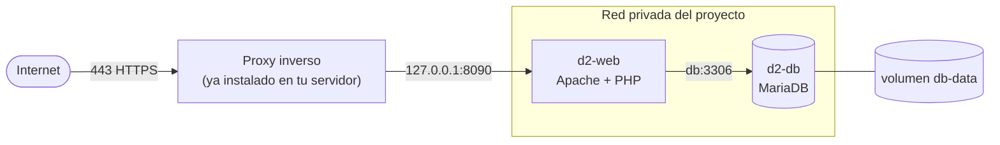

# Montar el juego en tu servidor con Podman (paso a paso)

Guía para hacerlo tú, con los conceptos explicados antes de usarlos. Orden: **conceptos → preparar el servidor → levantar → publicar con HTTPS → dejarlo estable**. Cada paso dice qué hace, por qué y cómo comprobar que salió bien. Si te pierdes, la sección 9 tiene los síntomas más probables.

> **Aviso honesto:** los archivos de `deploy/` no se han probado de punta a punta (el único intento se interrumpió antes de que arrancara el contenedor web). Es posible que tengas que ajustar algo; por eso cada paso tiene su comprobación: no sigas al siguiente hasta que la anterior dé lo esperado.

## 0. Conceptos (5 minutos)

| Concepto | Qué es | En este proyecto |
|---|---|---|
| **Imagen** | Una plantilla de solo lectura: sistema + programas + tu código, ya empaquetados | `localhost/d2-web` (la construyes tú) y `mariadb:10.11` (la descargas) |
| **Contenedor** | Una imagen en marcha: un proceso aislado con su propio sistema de archivos, red y límites | `d2-web` (Apache + PHP) y `d2-db` (MariaDB) |
| **Containerfile** | La receta para construir una imagen | [deploy/Containerfile](../deploy/Containerfile) |
| **Volumen** | Carpeta que **sobrevive** aunque borres el contenedor. Sin volumen, al recrear el contenedor la base se pierde | `db-data` guarda la base de datos |
| **Red de contenedores** | Red privada virtual: los contenedores de un mismo proyecto se ven por nombre y los de otros proyectos no | `tiendas-d2_interna`; el juego encuentra la base en el host `db` |
| **Puerto publicado** | Abre un contenedor al exterior: `127.0.0.1:8090:8080` = «lo que llegue al puerto 8090 de *este servidor, solo desde él mismo*, pásalo al 8080 del contenedor» | El juego solo; la base no se publica |
| **Rootless** | Podman corre con tu usuario, sin `root`. Si alguien rompe un contenedor, no manda en el servidor | Es lo normal en Podman |
| **Compose** | Un archivo que describe varios contenedores juntos, y un comando que los levanta | [deploy/compose.yaml](../deploy/compose.yaml) con `podman-compose` |
| **Proxy inverso** | Un programa en el servidor que recibe el tráfico web (80/443), pone el HTTPS y lo reparte a cada proyecto según el dominio | Caddy, nginx o Traefik; probablemente ya tienes uno |
| **Variables de entorno** | Forma de pasar contraseñas a un contenedor sin escribirlas en el código | `DB_USER`, `DB_PASS`, `ADMIN_TOKEN` en `deploy/.env` (que **no** va a git) |
| **SELinux (`:Z`)** | En Fedora/RHEL impide que un contenedor lea carpetas ajenas; `:Z` en un volumen le da permiso | Ya está puesto en `compose.yaml` |

**Cómo encaja todo:**



Dos ideas para quedarte: (1) **los contenedores se pueden borrar y recrear, los volúmenes no se tocan**, por eso se actualiza el juego sin perder datos; (2) **solo el proxy mira a internet**: el juego escucha en `127.0.0.1` y la base en nadie.

## 1. Preparar el servidor

**1.1 Comprueba lo instalado** (entra por SSH):

```bash
podman --version            # 4.x o superior
podman-compose --version
podman info | grep -i rootless      # debe decir: rootless: true  (si lo ves como tu usuario normal)
```
Si falta algo: `sudo dnf install podman podman-compose` (Fedora/RHEL) o `sudo apt install podman podman-compose` (Debian/Ubuntu).

**1.2 Que tu usuario pueda tener contenedores propios.** Rootless necesita un rango de ids reservado:
```bash
grep "^$USER:" /etc/subuid /etc/subgid
```
Debe salir una línea en cada archivo. Si no sale, un administrador debe ejecutar `sudo usermod --add-subuids 100000-165535 --add-subgids 100000-165535 TU_USUARIO`.

**1.3 Mira qué puertos usa ya tu servidor**, para no chocar con otros proyectos:
```bash
ss -ltn
```
Elige un puerto libre para el juego (el ejemplo usa `8090`) y anótalo.

**1.4 Proxy:** se usa **nginx**. Comprueba que está instalado y activo: `nginx -v` y `systemctl status nginx`. Mira qué sitios sirve ya (`ls /etc/nginx/conf.d /etc/nginx/sites-enabled`), porque el tuyo no debe pisarlos.

**1.5 Dominio:** de momento **no hay**, así que se entra por la IP del servidor y **sin HTTPS** (los certificados de Let's Encrypt necesitan un dominio). Cuando compres uno: crea el registro DNS `A` hacia la IP y sigue la sección 6.2.

**1.6 Cortafuegos:** abiertos solo 22 (SSH), 80 y 443. **No abras el 8090**: no hace falta y no debe verse desde fuera.

## 2. Traer el proyecto

```bash
cd ~
git clone git@github.com:AdrianCCRS/supermarkeyt-simulator.git tiendas-d2
cd tiendas-d2
ls deploy        # apache.conf  compose.yaml  Containerfile  db  env.example  php.ini
```

**Qué hace cada archivo de `deploy/`** (léelos una vez, son cortos):

| Archivo | Idea |
|---|---|
| `Containerfile` | Parte de `php:8.3-apache`, instala `pdo_mysql` (el conector de PHP a MySQL), cambia Apache al puerto 8080 y copia `public/` a `/var/www/html` y `src/` a `/var/www/src`. **`src/` queda fuera de la raíz web**: nadie puede pedirlo por HTTP |
| `apache.conf` | Esconde la versión de Apache y deja que `public/.htaccess` aplique la CSP y bloquee archivos ocultos |
| `php.ini` | No mostrar errores al visitante (van al log) |
| `compose.yaml` | Define los dos contenedores, su red, el volumen y los límites |
| `db/99-permisos.sh` | Al crear la base quita al usuario del juego todo menos `SELECT, INSERT, UPDATE` |
| `env.example` | Plantilla de los secretos |

## 3. Secretos

```bash
cd deploy
cp env.example .env
```
Genera tres valores **distintos** y pégalos en `.env`:
```bash
openssl rand -hex 24     # → DB_PASS
openssl rand -hex 24     # → DB_ROOT_PASS
openssl rand -hex 32     # → ADMIN_TOKEN
```
Edita con `nano .env`: ajusta también `WEB_PORT` al puerto que elegiste. Protege el archivo:
```bash
chmod 600 .env
```
> **Trampa clásica:** las contraseñas de la base se fijan **la primera vez que arranca `d2-db`** (al crear el volumen). Si después cambias `DB_PASS` en `.env`, la base conserva la antigua y el juego no conectará. Si te equivocas antes de tener datos reales: `podman-compose down -v` (borra el volumen) y empieza de nuevo.

Guarda estos tres valores también en tu gestor de contraseñas.

## 4. Construir y levantar

**4.1 Construir la imagen del juego.** Hazlo desde la **raíz** del proyecto (la carpeta que contiene `deploy/`, `public/` y `src/`), no desde `deploy/`: el `.` final es el «contexto» y el `COPY` busca `deploy/apache.conf`, `public/` y `src/` relativos a él.
```bash
cd ~/tiendas-d2          # la carpeta donde clonaste
ls                       # debes ver: deploy  public  src ...
podman build -f deploy/Containerfile -t localhost/d2-web:latest .
```
Comprueba: `podman images | grep d2-web`. La primera vez descarga PHP y compila la extensión; tarda unos minutos. Esto se hace de nuevo cada vez que cambias código del juego.

**4.2 Levantar los contenedores:**
```bash
cd deploy
podman-compose up -d
```
`-d` = en segundo plano. La primera vez descarga MariaDB.

**4.3 Mira cómo se inicia la base** (la primera vez crea las tablas y carga el catálogo):
```bash
podman-compose logs -f db
```
Espera a ver `ready for connections` y sal con `Ctrl+C`. Si ves errores de SQL, para y ve a la sección 9.

**4.4 Estado:**
```bash
podman ps
```
Deben aparecer `d2-db` (idealmente `healthy`) y `d2-web`, ambos `Up`.

## 5. Comprobar el juego (todavía sin HTTPS)

Desde el propio servidor:
```bash
curl -s http://127.0.0.1:8090/api/productos.php | head -c 300
```
Esperado: un JSON que empieza por `{"success":true,"data":[...`. Más comprobaciones de seguridad:

```bash
curl -sI http://127.0.0.1:8090/ | grep -i content-security       # sale la política CSP
curl -s -o /dev/null -w '%{http_code}\n' http://127.0.0.1:8090/.htaccess    # 403
curl -s -o /dev/null -w '%{http_code}\n' http://127.0.0.1:8090/src/bootstrap.php   # 404 (src no existe en la raíz web)
curl -s -X POST http://127.0.0.1:8090/api/producto_reponer.php -d '{}' | head -c 200   # 403: sin token no hay admin
```
Para verlo en el navegador de tu PC sin abrir puertos, un túnel SSH:
```bash
ssh -L 8090:127.0.0.1:8090 usuario@tu-servidor
```
y abre `http://localhost:8090` en tu PC. Juega una venta completa y cierra la jornada.

## 6. Publicarlo con nginx

El proxy recibe el tráfico y lo reenvía al `127.0.0.1:8090`.

### 6.1 Ahora, sin dominio (HTTP por la IP)

Crea `/etc/nginx/conf.d/d2.conf` (con `sudo`). Si el puerto 80 ya lo usa otro proyecto de tu servidor, usa un puerto propio (aquí 8081) para no tocarlo:
```nginx
server {
    listen 8081;                 # el que esté libre (ss -ltn); abre ese puerto en el cortafuegos
    server_name _;
    client_max_body_size 128k;   # la API no recibe cuerpos grandes

    location / {
        proxy_pass http://127.0.0.1:8090;
        proxy_set_header Host $host;
        proxy_set_header X-Forwarded-For $remote_addr;
    }
}
```
```bash
sudo nginx -t && sudo systemctl reload nginx      # nginx -t revisa la sintaxis ANTES de aplicar
sudo ufw allow 8081/tcp                           # o firewall-cmd, según tu sistema
curl -s http://IP_DEL_SERVIDOR:8081/api/productos.php | head -c 200
```
Abre `http://IP_DEL_SERVIDOR:8081` en el navegador.

> **Sin HTTPS no uses esto con desconocidos:** el identificador del jugador viaja en claro y el token de admin también si lo usas desde fuera. Para amigos está bien; el token de admin úsalo solo por túnel SSH o desde el propio servidor. **No actives HSTS** hasta tener HTTPS (bloquearía el sitio).

### 6.2 Cuando tengas dominio

Crea el registro DNS `A` hacia la IP, cambia en `d2.conf` `listen 8081;` por `listen 80;` y `server_name _;` por `server_name d2.tudominio.com;`, añade `proxy_set_header X-Forwarded-Proto $scheme;`, recarga y saca el certificado:
```bash
sudo certbot --nginx -d d2.tudominio.com      # instala el certificado y redirige a HTTPS
curl -sI https://d2.tudominio.com/api/productos.php      # HTTP/2 200
```
Con HTTPS funcionando, **activa HSTS**: en [public/.htaccess](../public/.htaccess) quita el `#` de la línea `Strict-Transport-Security`, `git pull` en el servidor, repite el paso 4.1 y `podman-compose up -d`.

### 6.3 Límite de peticiones

El juego no limita nada; el sitio natural es el proxy (ver [PUBLICAR.md](PUBLICAR.md) §6). Mínimo si es para amigos: nada. Si lo abres a todo el mundo: `limit_req` en nginx o Cloudflare delante.

## 7. Que sobreviva a un reinicio

Con `restart: always` en el compose, Podman reinicia los contenedores, pero **solo si el servicio de usuario está activo y la sesión no es necesaria**. Una sola vez:
```bash
loginctl enable-linger $USER
systemctl --user enable --now podman-restart.service
```
**Pruébalo de verdad** (la comprobación vale más que la teoría): `sudo reboot`, espera un minuto, reconecta y haz `podman ps`. Deben estar `Up` sin que hagas nada. Si no, es el único paso que merece revisión antes de fiarte.

## 8. Mantenimiento

**Copia de seguridad** (haz una ya y comprueba que el archivo pesa algo):
```bash
podman exec d2-db sh -c 'mariadb-dump -uroot -p"$MARIADB_ROOT_PASSWORD" --single-transaction supermarket_simulator' > ~/copia-$(date +%F).sql
ls -lh ~/copia-*.sql
```
Prográmala a diario con `crontab -e` y copia los archivos **fuera del servidor** (una copia en la misma máquina no sirve si se pierde la máquina). **Una copia que nunca restauraste no es una copia**: pruébalo una vez con `podman exec -i d2-db sh -c 'mariadb -uroot -p"$MARIADB_ROOT_PASSWORD" supermarket_simulator' < copia.sql`.

**Actualizar el juego:**
```bash
cd ~/tiendas-d2 && git pull
podman build -f deploy/Containerfile -t localhost/d2-web:latest .
cd deploy && podman-compose up -d
```
La base no se toca. Si la actualización cambia el esquema, habrá un `.sql` de migración que ejecutarás con `podman exec -i d2-db …` (se avisará en el commit).

**Actualizar MariaDB/PHP:** de vez en cuando `podman pull docker.io/library/mariadb:10.11` y `podman-compose up -d`; y reconstruir el juego (4.1) trae el PHP más reciente de su versión. Haz antes una copia.

**Ver cuánto consume:** `podman stats --no-stream`.

## 9. Si algo falla

| Síntoma | Causa probable y qué hacer |
|---|---|
| `COPY ... no such file or directory` al construir | Estás construyendo desde `deploy/` (el contexto es `deploy/`). Vuelve a la raíz del proyecto y repite el `podman build` de 4.1 |
| `pinging container registry localhost` | Falta construir la imagen (4.1). `localhost/d2-web` es local, no se descarga |
| `podman ps` no muestra `d2-web` | `podman-compose logs web` o `podman logs d2-web`. Si habla de permisos o PID: en `compose.yaml` quita temporalmente `read_only: true`, vuelve a `up -d`; si así funciona, el problema es de qué carpetas necesita escribir Apache |
| `productos.php` responde 500 | `podman-compose logs web` (error PHP) y `logs db`. Casi siempre: base sin importar, o `DB_PASS` distinta a la del volumen ya creado (ver el aviso del paso 3) |
| La base no importó nada | Los `.sql` solo corren con el volumen **vacío**. `podman-compose down -v` y `up -d` de nuevo |
| `Permission denied` leyendo `../database/...` | SELinux: el `:Z` del compose debe estar; si moviste archivos, vuelve a hacer `up -d` |
| `address already in use` | Puerto ocupado: cambia `WEB_PORT` en `.env` y el del proxy |
| Funciona por `127.0.0.1` pero no por el dominio | DNS aún no propagado, cortafuegos sin 80/443, o proxy mal recargado: `curl -I http://d2.tudominio.com` y logs del proxy |
| No arranca tras reiniciar | Falta `enable-linger` o `podman-restart.service` (sección 7) |
| El navegador no carga scripts o estilos | La CSP se cargó pero algo se pide fuera de tu dominio; abre la consola del navegador (F12) y busca «Content Security Policy» |

**Comandos que usarás siempre:**

| Para | Comando |
|---|---|
| Ver contenedores | `podman ps -a` |
| Logs | `podman-compose logs -f web` / `db` |
| Entrar a un contenedor | `podman exec -it d2-web bash` · `podman exec -it d2-db mariadb -uroot -p` |
| Reiniciar uno | `podman restart d2-web` |
| Parar todo (conserva datos) | `podman-compose down` |
| Parar y **borrar la base** | `podman-compose down -v` |
| Limpiar imágenes viejas | `podman image prune` |

## 10. Autoevaluación

1. ¿Qué pasa con la base de datos si borras el contenedor `d2-db`? ¿Y si borras el volumen?
2. ¿Por qué el juego se publica en `127.0.0.1:8090` y no en `0.0.0.0:8090`?
3. ¿Por qué `src/` está fuera de `/var/www/html` dentro de la imagen?
4. ¿Por qué cambiar `DB_PASS` en `.env` después de crear la base no la cambia?
5. ¿Qué diferencia hay entre reconstruir la imagen (`podman build`) y reiniciar el contenedor?
6. ¿Qué aporta el proxy inverso que el contenedor no hace por sí solo?
7. ¿Qué privilegios tiene el usuario de la base del juego y por qué no `DELETE`?
